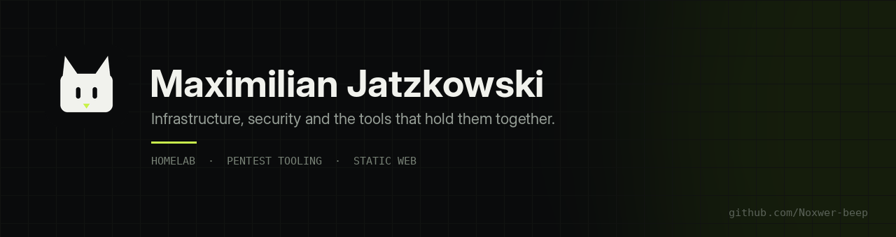

  

 

I'm Max — an IT student in Germany who builds infrastructure he can explain, and the
tools that keep it honest. Most of what is here comes out of one question: *does the
thing still work the way I said it did?*

Everything is hand-written, documented and tested. No frameworks for their own sake,
no tooling I can't read end to end.

---

### Selected work

| Project | What it is | Stack |
|---|---|---|
| **[Vantage](https://github.com/Noxwer-beep/vantage)** | Authorized network recon and vulnerability triage. Deny-by-default scope gate, graded findings, live CLI dashboard, local web console. | `Python` `nmap` `SQLite` |
| **[Warden](https://github.com/Noxwer-beep/warden)** | Homelab inventory, health and drift. One TOML file declares what should run; it checks, remembers, and reports what changed. | `Python` `TOML` `SQLite` |
| **[Portfolio](https://github.com/Noxwer-beep/portfolio)** | The site itself — hand-written, no build step, dark-first, with a case study for each project. [Live](https://noxwer-beep.github.io/portfolio/) | `HTML` `CSS` `JS` |
| **[Showcase](https://github.com/Noxwer-beep/showcase)** | Eight different arguments about how a homepage should behave. Same content, eight design directions. [Live](https://noxwer-beep.github.io/showcase/) | `HTML` `CSS` `JS` |
| **[Homelab](https://github.com/Noxwer-beep/homelab-infrastructure)** | How the lab is put together: Proxmox, OPNsense, VLANs, and the reasoning behind each decision. | `Docs` |

---

### What I'm on right now

- Refining **Warden** against the real lab — UDP probes, weekly digests, drift history.
- Building out **Vantage**'s reporting so a finding reads like a paragraph, not a raw line.
- Writing the homelab down properly: every decision gets a note, or it didn't happen.

### How I work

> If I can't explain why it is configured that way, it isn't finished.

- **Read the thing.** Parse the XML, read the RFC, check what the header actually says.
- **Test against reality.** Sockets, real HTTP, real TLS — mocks lie politely.
- **Document the decision, not the keystrokes.** The runbook is for the person at 3am.
- **Deny by default.** In firewall rules, in scope gates, and in feature flags.

### Tools I reach for

`Linux` · `Python` · `Bash` · `nmap` · `Proxmox` · `OPNsense` · `SQLite` · `Flask` ·
`Podman` · `Git` · `Obsidian`

---

  
    <a href="https://noxwer-beep.github.io/portfolio/">portfolio</a> ·
    <a href="mailto:jatzkowski.maximilian@gmail.com">email</a>
  

